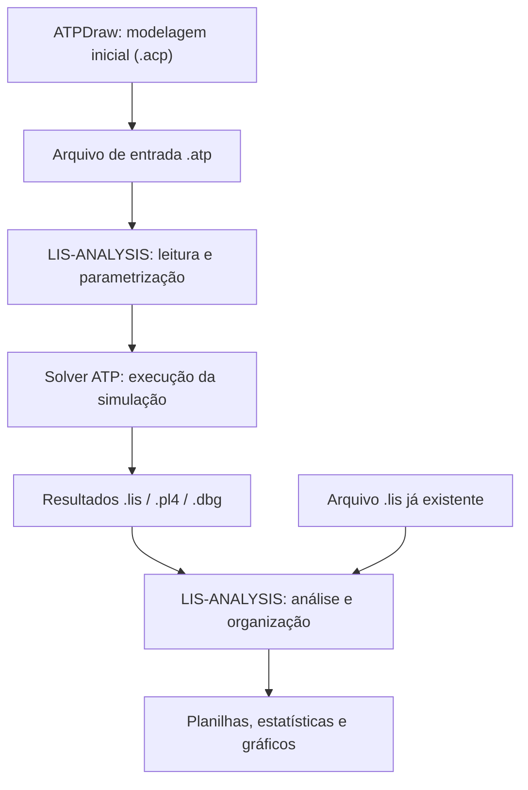

# LIS-ANALYSIS

**Automação de simulações no ATP e análise de resultados em Python.**

O **LIS-ANALYSIS** é uma aplicação com interface gráfica que auxilia estudos de transitórios eletromagnéticos, integrando a execução de simulações no *Alternative Transients Program* (ATP) ao processamento de seus arquivos de saída.

O projeto reúne duas frentes complementares: **parametrização e automação de simulações**, a partir de arquivos `.atp`, e **análise de resultados**, a partir de arquivos `.lis`. O objetivo é reduzir etapas manuais e facilitar a organização e a interpretação de diferentes casos de estudo.

> **Importante:** o LIS-ANALYSIS não substitui o ATP nem o ATPDraw. O ATP continua responsável pelos cálculos elétricos; o ATPDraw pode ser utilizado para a modelagem gráfica inicial dos circuitos.

## Funcionalidades

### Simulação e parametrização

- Seleção de arquivos `.atp` e do executável ATP (`tpbig.exe` ou `runATP.exe`), com opção de localização automática do solver.
- Identificação de parâmetros editáveis em seções como `/BRANCH`, `/SWITCH` e `/SOURCE`.
- Alteração de parâmetros elétricos com preservação dos campos de largura fixa do arquivo `.atp`.
- Execução do ATP como processo externo, com acompanhamento de estado, progresso e mensagens de erro.
- Execução em lote por varredura paramétrica, com configurações individuais e possibilidade de processamento sequencial ou paralelo, conforme as condições de execução.
- Organização dos arquivos e registro das alterações realizadas.

### Análise de resultados

- Leitura de arquivos `.lis` produzidos pelo ATP, inclusive resultados já existentes.
- Extração de distribuições de sobretensões, estatísticas e séries temporais, quando presentes no arquivo.
- Geração de planilhas Excel e gráficos, incluindo histogramas, distribuições acumuladas, ajustes gaussianos e séries temporais.
- Comparação de resultados entre casos.
- Cálculo de indicadores de risco de falha mediante configuração dos parâmetros necessários.

A disponibilidade de cada análise depende das informações contidas no arquivo `.lis` utilizado.

## Como funciona



Na abordagem utilizada pelo projeto, o circuito é inicialmente preparado no ATPDraw, que gera o arquivo `.atp` empregado pelo solver. A ferramenta Python trabalha diretamente com esse arquivo de entrada: identifica campos editáveis, aplica alterações pontuais e inicia novas simulações por meio de processos externos. Depois, recupera e analisa os arquivos produzidos.

**Não há conversão automática de `.acp` para `.atp` na aplicação.** A comunicação com o ATP utiliza arquivos no disco e a execução do solver, sem depender de uma API específica do simulador.

## Requisitos

- **Python 3.11** recomendado (versão utilizada nos builds automatizados do repositório).
- Dependências Python listadas em [`requirements.txt`](requirements.txt).
- Para **analisar arquivos `.lis` existentes**, não é necessário executar o ATP.
- Para **realizar novas simulações**, é necessário ter uma instalação funcional do ATP e acesso a um solver compatível. No fluxo Windows, são aceitos `tpbig.exe` e `runATP.exe`.
- O ATPDraw é utilizado quando é necessário criar ou preparar graficamente um circuito; não é exigido para abrir um `.lis` já disponível.

## Instalação e execução

Clone o repositório e instale as dependências em um ambiente virtual:

```bash
git clone https://github.com/Jottynha/LIS-ANALYSIS.git
cd LIS-ANALYSIS
python -m venv .venv
```

Ative o ambiente virtual:

**Windows (PowerShell)**

```powershell
.\.venv\Scripts\Activate.ps1
```

**Linux**

```bash
source .venv/bin/activate
```

Instale as dependências e inicie a interface:

```bash
python -m pip install -r requirements.txt
python run.py --gui
```

> No Linux, a interface requer suporte ao Tk. A execução de um solver Windows (`.exe`) depende de um ambiente compatível; a existência de um build Linux da aplicação não garante a execução nativa do ATP nesse sistema.

### Analisar arquivos `.lis` pela linha de comando

A aplicação também disponibiliza um modo de processamento sem abrir a interface:

```bash
python run.py --lis "caminho/para/resultado.lis" --outdir "Simulation_Result"
```

Para consultar as opções disponíveis:

```bash
python run.py --help
```

## Exemplo de varredura paramétrica

Para estudar diferentes valores de uma resistência, é possível definir uma sequência, por exemplo:

| Configuração | Resistência |
| --- | ---: |
| 1 | 5 Ω |
| 2 | 6 Ω |
| 3 | 7 Ω |
| 4 | 8 Ω |
| 5 | 9 Ω |
| 6 | 10 Ω |

A ferramenta prepara uma versão do arquivo `.atp` para cada valor, preservando os demais campos, e organiza os casos em diretórios individuais. O plano da varredura é registrado em `plano_execucao.json`. A geração das configurações não implica, por si só, que todas as simulações tenham sido concluídas com sucesso.

## Arquivos de saída

Dependendo da operação e do conteúdo da simulação, a aplicação pode produzir ou preservar:

| Arquivo | Finalidade |
| --- | --- |
| `.atp` | Entrada parametrizada utilizada na simulação |
| `.lis` | Saída textual produzida pelo ATP |
| `.pl4` e `.dbg` | Arquivos complementares do ATP, quando gerados |
| `.xlsx` | Tabelas, estatísticas e dados processados |
| `.png` | Visualizações e gráficos |
| `parametros_aplicados.json` | Registro dos parâmetros modificados |
| `plano_execucao.json` | Registro das configurações de uma varredura |

## Organização do repositório

```text
LIS-ANALYSIS/
├── src/lis_analysis/       # Código da aplicação
│   ├── atp_parser.py       # Leitura e identificação de parâmetros
│   ├── atp_writer.py       # Escrita de arquivos .atp parametrizados
│   ├── batch_runner.py     # Coordenação de execuções em lote
│   ├── solver/atp_runner.py # Execução e monitoramento do solver
│   ├── main.py             # Processamento e análise de arquivos .lis
│   └── gui.py              # Interface gráfica
├── data/samples/           # Arquivos de exemplo
├── tests/                  # Testes automatizados
├── docs/                   # Documentação complementar
├── scripts/                # Scripts auxiliares
├── requirements.txt
└── run.py                  # Ponto de entrada
```

## Desenvolvimento e documentação

O repositório contém testes para leitura e escrita de arquivos ATP, execução do solver, varreduras paramétricas e comportamentos da interface. Também possui scripts de empacotamento e um fluxo de build para Windows e Linux.

Consulte:

- [Estrutura do repositório](docs/REPO_STRUCTURE.md)
- [Instruções de geração de executáveis](docs/BUILD_EXE.md)
- [Amostras de entrada e resultados](data/samples/README.md)

## Contexto acadêmico

Projeto desenvolvido no contexto de atividades de **Iniciação Científica do Centro Federal de Educação Tecnológica de Minas Gerais (CEFET-MG), Campus Divinópolis**, envolvendo automação de simulações de transitórios eletromagnéticos e análise computacional dos resultados.

**Estado do projeto:** em desenvolvimento. Os formatos reconhecidos, os casos de simulação e os indicadores gerados dependem dos dados de entrada e das condições do ambiente ATP.
